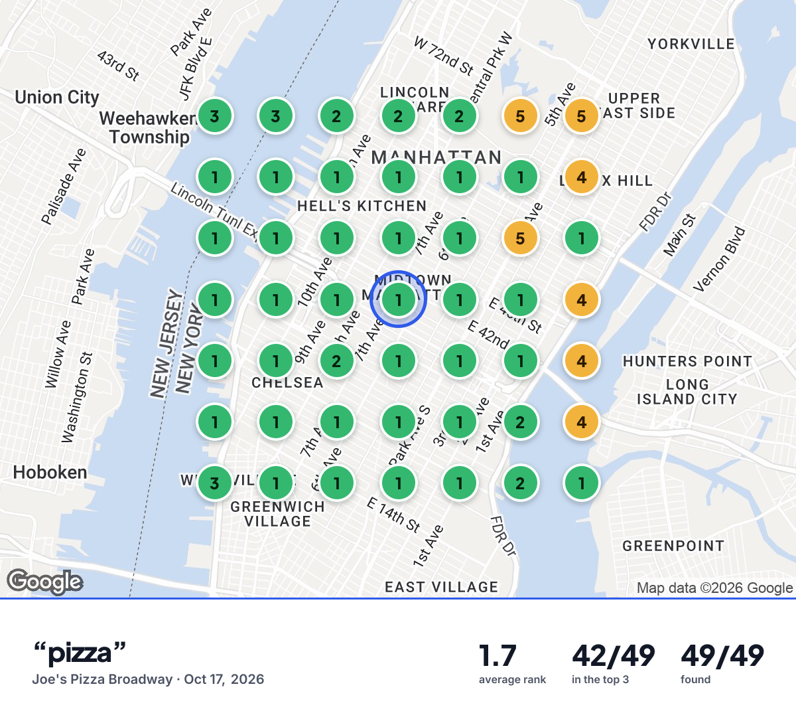
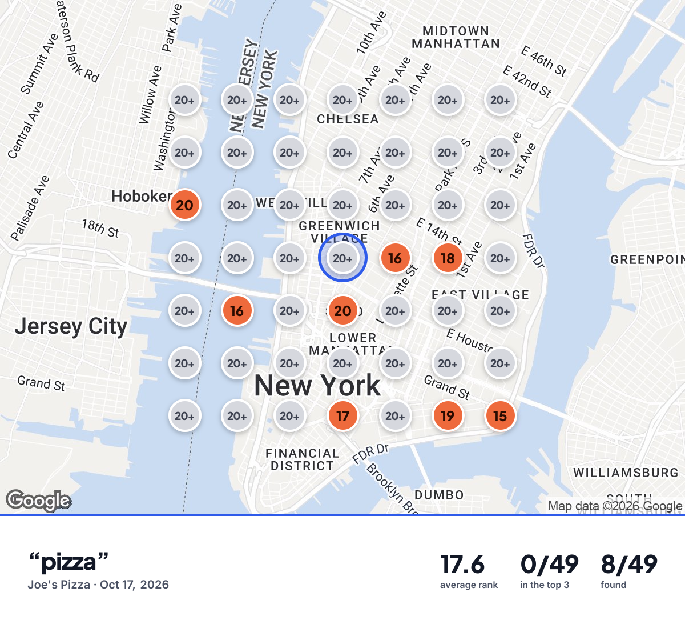
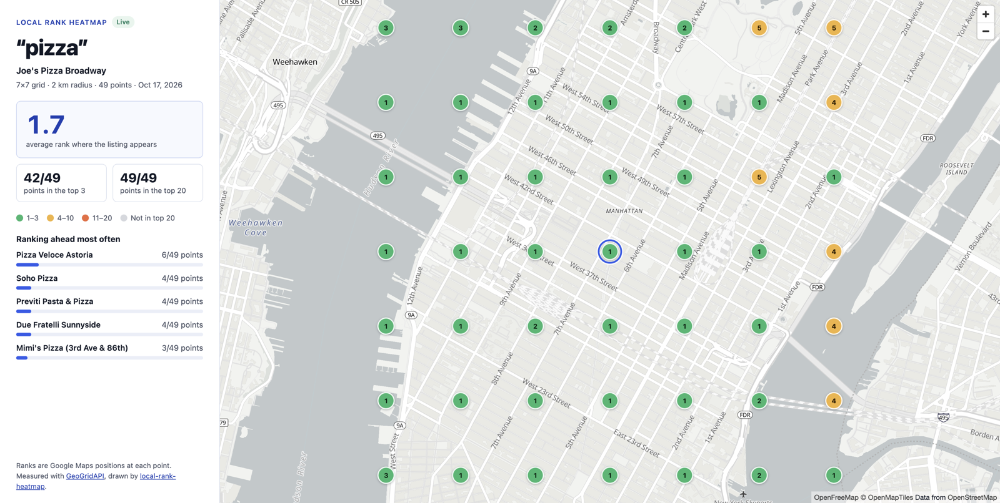

# Local Rank Heatmap

[](https://github.com/geogridapi/local-rank-heatmap/actions/workflows/test.yml)
[](LICENSE)


See where a business ranks on Google Maps, block by block.

One command turns a Google Business Profile and a keyword into a local SEO **geo-grid heatmap**: an interactive map, a PNG for your client report, a CSV for your spreadsheet. No dependencies, nothing to build.

| Joe's Pizza Broadway | Joe's Pizza, Carmine Street |
|---|---|
|  |  |
| #1 on 33 of 49 points, top 3 on 42 | Outside the top 20 on 41 of 49 points, never in the top 3 |

Same brand, same keyword, two shops 3 km apart in Manhattan: 7×7 grids of 2 km measured on October 17, 2026. Open the interactive maps: [Broadway](https://geogridapi.github.io/local-rank-heatmap/) · [Carmine Street](https://geogridapi.github.io/local-rank-heatmap/carmine-st.html).

## Quick start

```bash
git clone https://github.com/geogridapi/local-rank-heatmap.git
cd local-rank-heatmap
cp .env.example .env        # then paste your GeoGridAPI key in .env
node heatmap.js "Joe's Pizza Broadway, New York" "pizza"
```

You need Node.js 20.12 or later and a GeoGridAPI key: [create a free account](https://geogridapi.io/en/signup) (500 free credits, no card), then create a key in the console. A `gga_test_` key is free and returns sample grids, enough to try everything; a `gga_live_` key measures the real Google Maps results.

Without cloning:

```bash
GEOGRIDAPI_API_KEY=gga_test_… npx github:geogridapi/local-rank-heatmap "Joe's Pizza Broadway, New York" "pizza"
```

## What you get

```text
output/joe-s-pizza-broadway-new-york-pizza-2026-10-17/
├── heatmap.html   interactive map: click a point to see the top 3 listings there
├── heatmap.png    1200 × 1092 image on a Google Maps background, ready for a report
├── ranks.csv      one row per point: position, coordinates, rank, top 3
└── grid.json      the full API response (ranks, competitors, change since last grid)
```

The terminal shows the grid right away, north at the top:

```text
   3    3    2    2    2    5    5
   1    1    1    1    1    1    4
   1    1    1    1    1    5    1
   1    1    1    1    1    1    4
   1    1    2    1    1    1    4
   1    1    1    1    1    2    4
   3    1    1    1    1    2    1

"pizza" around Joe's Pizza Broadway (live)
Average rank 1.7 where found · top 3 on 42/49 points · found on 49/49
Ranking ahead most often:
  Pizza Veloce Astoria: ahead on 6 points, #1 on 2
  Soho Pizza: ahead on 4 points, #1 on 4
  Previti Pasta & Pizza: ahead on 4 points, #1 on 2
```

The average rank counts the points where the business appears; `grid.json` also has `average_rank_with_misses`, which counts every other point as 21.



## Options

```text
node heatmap.js "<business name, city>" "<keyword>" [options]
node heatmap.js --place-id ChIJ… --keyword "<keyword>" [options]
node heatmap.js --grid-id <id>    finish or redraw a grid you already ran, at no cost

--size <3|5|7|9>      Square grid side (default 7, so 49 points)
--shape <shape>       square (default), circle, diamond, hexagon, cross, ellipse, rectangle
--density <level>     low, medium or high, for shapes other than the square
--radius <km>         Distance from the center to the edge (0.5 to 30 km; 1 to 30 for other shapes)
--language <code>     Search language, 2 letters
--country <code>      Search country, 2 letters
--out <dir>           Output folder
--no-image            Skip the PNG map
--yes, -y             Run a paid grid without asking
```

## How it works

Google Maps does not show the same results everywhere: what a customer sees depends on where they stand when they search. A geo-grid places points around the business and records its position in the Google Maps results at each one. Green dots are where customers find it, grey dots are where they find competitors.

The script calls the [GeoGridAPI](https://geogridapi.io) REST API: it prices the grid first (`POST /v1/grids/estimate`), creates it (`POST /v1/grids`), polls it until it is completed (`GET /v1/grids/{id}`), then downloads the image. Ranks are positions 1 to 20; `20+` means the business is not in the top 20 at that point.

The grid ID is printed as soon as the grid is created. If your connection drops, `node heatmap.js --grid-id <id>` picks it up again without paying twice. Network errors and 5xx answers are retried with the same `Idempotency-Key`.

## Cost

1 credit per grid point: a 7×7 grid is 49 credits. Credit packs start at €20 for 10,000 credits and never expire. Test keys cost nothing. Before a paid grid, the script shows the price and your balance and asks for confirmation (`--yes` skips the question, for cron jobs).

## Automate it

- **n8n**: three ready-made workflows in [`n8n/`](n8n/) (weekly email report, Google Sheets rank tracker, Slack alert when a ranking drops).
- **Claude, Cursor and other AI assistants**: [geogridapi-mcp](https://github.com/geogridapi/geogridapi-mcp) gives them the same grids through MCP.
- **Your own code**: [API documentation](https://geogridapi.io/en/docs), with webhooks, batches of 50 grids and weekly or monthly repeats.

## FAQ

**Does this scrape Google from my machine?** No. The measuring runs on GeoGridAPI's servers; this script only calls its REST API and draws the result.

**Which map does the HTML page use?** [OpenFreeMap](https://openfreemap.org) vector tiles (OpenStreetMap data) through MapLibre: free, no key, and it works when you open the file from your disk.

**Can I measure a business without a public address?** Use `--place-id` with its Google place ID; service-area businesses with no location cannot be centered automatically.

## License

[MIT](LICENSE) © Localnord, LLC (GeoGridAPI). The sample PNG maps in `examples/` include map data © Google; they show what the tool produces and are not covered by the MIT license.
